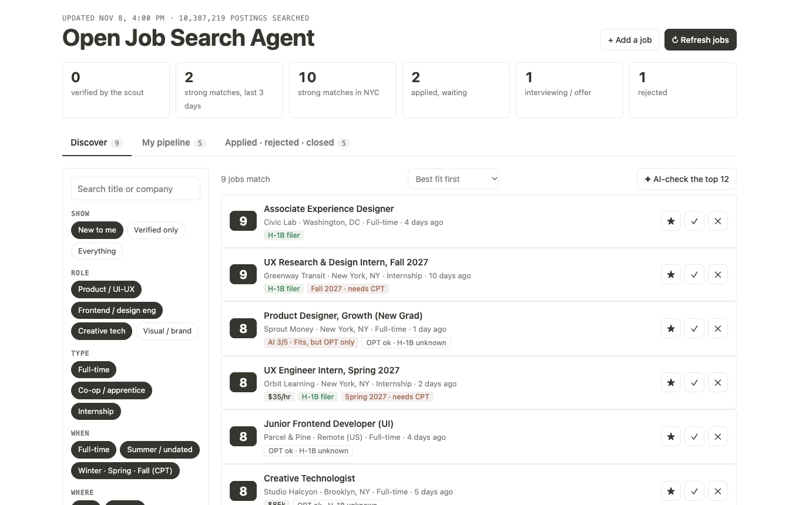
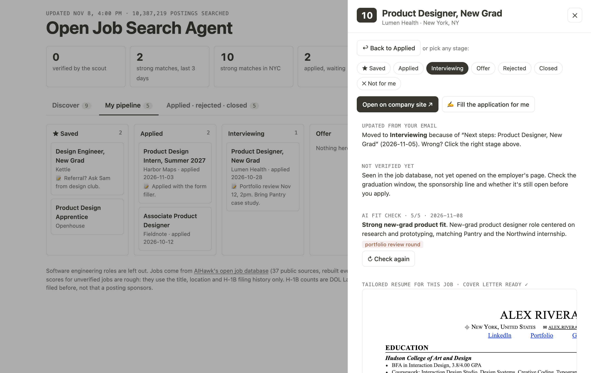
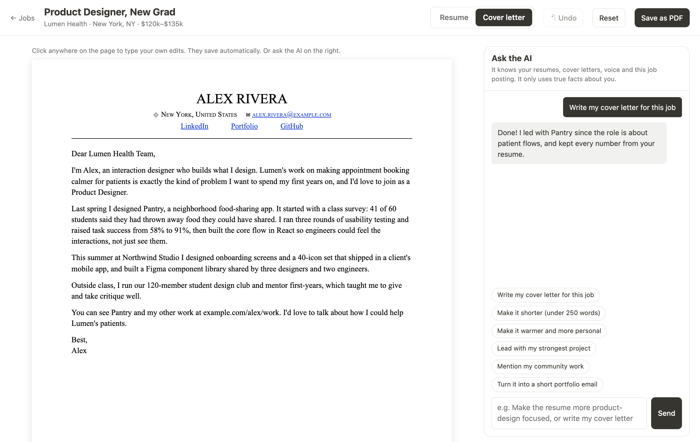
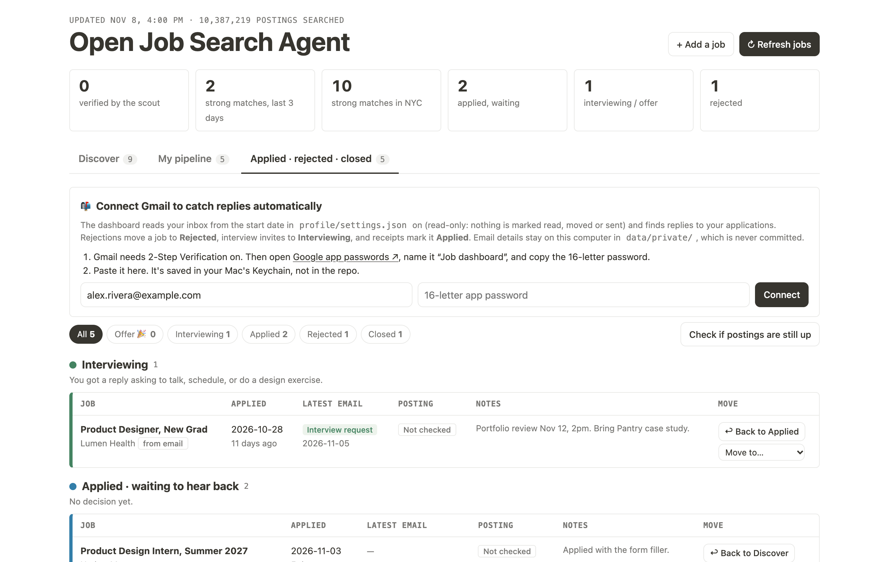
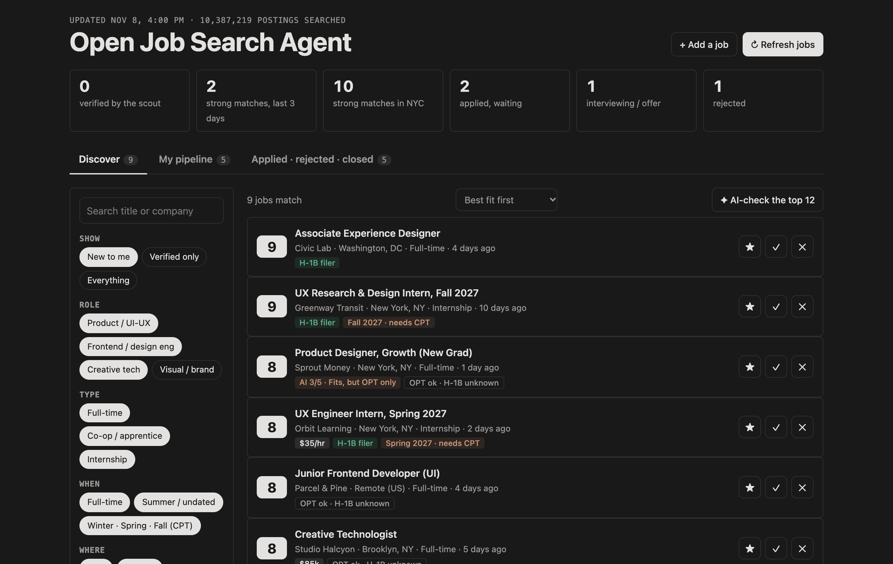

# Open Job Search Agent

**An open-source reference build of an AI job-search assistant for international design students.** It finds entry-level product design, UI/UX and design-engineering roles, checks visa fit, tailors a resume and cover letter for each job, fills in the application form, and tracks replies from the inbox. The candidate stays in control: it never presses Submit.

This repo is a working template filled with a **made-up candidate ("Alex Rivera") and fictional jobs**. Fork it, swap in your own profile, and use it as a starting point for your own job-search bot.



---

## The problem it solves

A first design job search on an F-1 visa means running the same five checks on every posting:

1. Is it really entry level, or does it want three years of experience?
2. Will they hire someone on OPT? Have they ever sponsored an H-1B?
3. Does the internship require going back to school afterward, which rules out the summer after graduation?
4. Which projects should the application lead with for this role?
5. Was there a reply, or a quiet rejection?

Job boards don't answer these questions, and most auto-apply bots send the same resume to every posting. Open Job Search Agent takes the opposite approach: fewer, better applications, each one tailored, with the final decision left to the person applying.

## What it does

| | |
|---|---|
| **Find** | Searches an open database of 10M+ postings from 37 sources, rebuilt every 5 hours (from the open-source [AIHawk](https://github.com/feder-cr/Jobs_Applier_AI_Agent) project). Filters out software-engineering and senior roles, then scores each job 1–10 on role, path to full-time, location, sponsorship history and level. |
| **Check the visa line** | Shows each employer's H-1B filing history from public Department of Labor data, labels "OPT only" postings, and flags semester internships that need CPT. |
| **AI fit check** | Claude reads the real job description and rates the fit 1–5, with red flags like "clearance required", "really a backend role" or "deadline in 7 days". Word matching alone is noisy; reading the description catches what titles hide. |
| **Tailor** | Builds a one-page resume for each job by picking and ordering lines from one source-of-truth file. It never invents experience. |
| **Studio** | The resume and cover letter side by side with an AI chat: "make it more product-focused", "write my cover letter", "shorter and warmer". You can also type straight onto the page. |
| **Apply** | Opens the company's form in Chrome, uploads the tailored PDFs and fills the standard questions. It knows how Greenhouse, Lever, Ashby, Workday and SmartRecruiters forms behave. **It stops before Submit.** When you submit and the site confirms it, the job is marked Applied and the confirmation screenshot is saved. |
| **Track** | Pipeline from Saved to Applied to Interviewing to Offer, plus Rejected and Closed. Reads your Gmail (read-only) to move jobs when a rejection or interview invite arrives. Every move can be undone. |







## Design decisions

- **The person presses Submit.** Design roles depend on a portfolio, and some employers ban AI-written applications. The bot does the repetitive 90%; you review and send.
- **One source of truth, no invented facts.** Every resume line lives in `profile/resume.json`. The tailoring step only selects and reorders lines, and the AI is told to rephrase without inventing employers, numbers or tools.
- **Outcomes, not just a list.** The tracker is split by result (interviewing, waiting, rejected, closed), because that's what matters during a search. Each row shows the latest email and "no reply in 27 days" nudges.
- **Calm interface.** Black and white, one accent for status, and dense but readable, like a notebook. Light and dark mode.
- **Local and private by default.** It runs on your own computer. The AI runs through your own Claude Code login, the Gmail password is kept in the macOS Keychain, and email details and screenshots are never committed.



## How it works

```
profile/            who the candidate is (sample data: replace with yours)
  settings.json     name, school, alumni searches, email start date…
  resume.json       every true resume line, tagged by role type
  candidate.md      goals and work-authorization rules
  voice.md          how they write cover letters
  answers.json      what the form filler types
app/
  server.py         local server (127.0.0.1 only): jobs, tracker, AI, form filler, Gmail
  index.html        dashboard (vanilla JS, no build step)
  studio.html       resume and cover letter editor with AI chat
  tailor.js         picks the best resume lines for a job
  ai.py             Claude prompts: Studio chat and fit check (via `claude -p`)
scripts/
  fetch_jobs.py     queries the 10M-posting database with DuckDB, filters and scores
  h1b_lookup.py     H-1B filing history per employer
  autofill.py       Playwright form filler with per-site know-how (never submits)
  inbox.py          Gmail reader (IMAP, read-only) that classifies replies
SCOUT.md            instructions for a daily Claude Code "scout" run that verifies jobs by hand
```

**Stack:** Python standard library, DuckDB, Playwright, vanilla HTML/CSS/JS, and the Claude Code CLI for AI.

## Run it

You need macOS, Python 3.11+, Google Chrome and [Claude Code](https://claude.com/claude-code) (for the AI features).

```bash
git clone https://github.com/<you>/open-job-search-agent && cd open-job-search-agent
python3 -m venv .venv && .venv/bin/pip install duckdb playwright
./run.sh            # opens http://127.0.0.1:8765 with the sample data
./run.sh --refresh  # pulls real jobs from the open database
```

To make it yours, edit the files in `profile/`. Try the form filler on a posting without sending anything:

```bash
.venv/bin/python scripts/autofill.py <job posting URL> --check
```

## Credits

- Job data: [AIHawk's open job database](https://huggingface.co/datasets/feder-cr/jobs) (MIT). AIHawk's site notes also inspired the form filler and fit check.
- H-1B data: Department of Labor LCA disclosures via h1bdata.info. A filing shows an employer has sponsored before, not that a specific posting will.

## Contributing

Issues and pull requests are welcome, especially support for more application sites (iCIMS, Taleo, Workable) and email providers beyond Gmail.

All people, companies and jobs in this repo are fictional.
